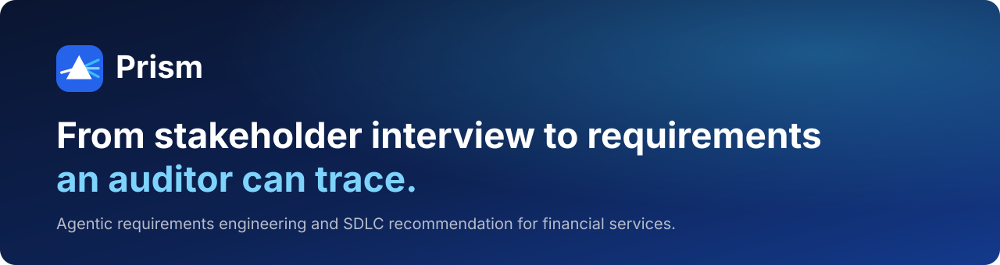
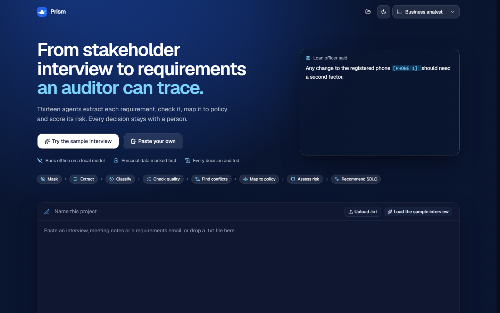
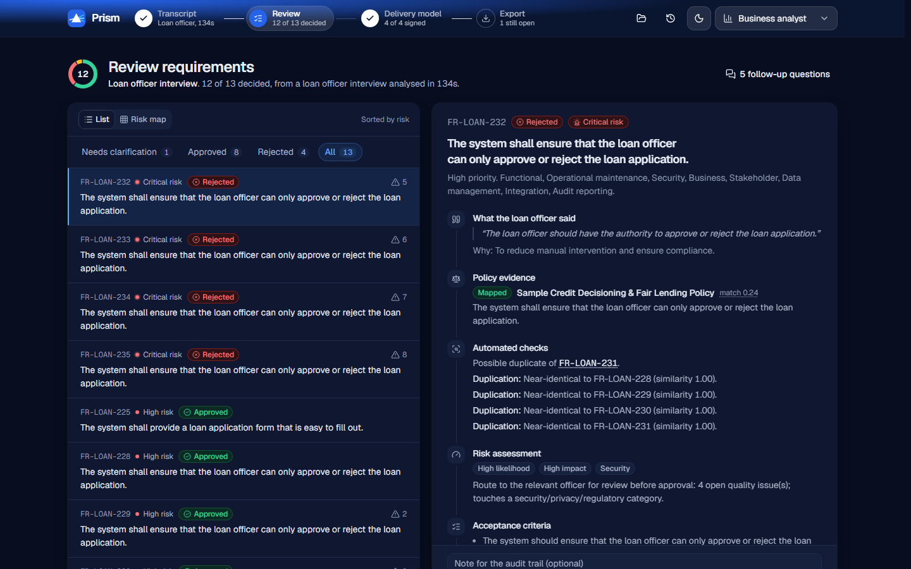
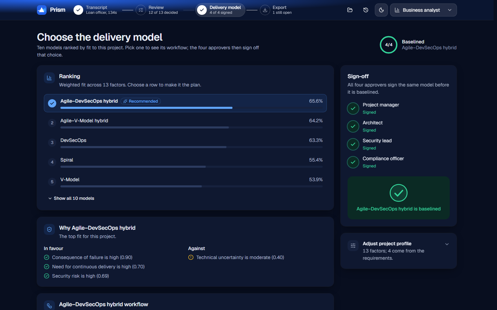
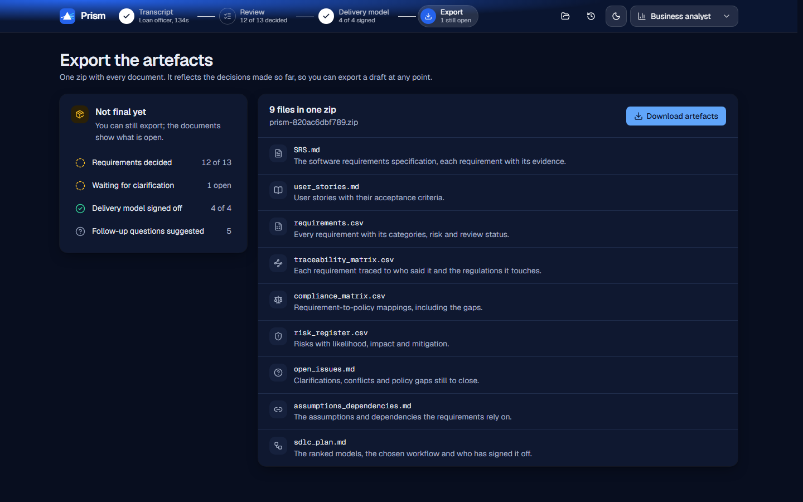

<p align="center">
  
</p>

<p align="center">
  
  
  
  
  
</p>

<p align="center">
  <b>Prism</b> turns a stakeholder interview into reviewed, policy-mapped,
  risk-assessed requirements, recommends a delivery model, and generates the
  supporting documents.<br>
  Nothing becomes final until a person accepts it.
</p>

<p align="center">
  <a href="#quick-start">Quick start</a> ·
  <a href="#screenshots">Screenshots</a> ·
  <a href="#how-it-works">How it works</a> ·
  <a href="#security-and-governance">Security</a> ·
  <a href="docs/SDLC.md">How it was built</a>
</p>

> The web UI is branded *Prism*. The Python package, CLI and `FINREQ_*`
> environment variables keep the project's original name, **FinReq**.

## Highlights

<table>
  <tr>
    <td width="33%"><br><b>Traceable</b><br>Every requirement links back to the stakeholder's words, the policy evidence behind it and its risk score.</td>
    <td width="33%"><br><b>Human in the loop</b><br>Only an explicit accept, reject or edit changes status. The SDLC choice needs four role sign-offs.</td>
    <td width="33%"><br><b>Private by design</b><br>PII is masked before any model call. Runs fully offline with a local Ollama model.</td>
  </tr>
  <tr>
    <td><br><b>Explainable</b><br>Quality, conflict, risk and SDLC ranking are plain rules, so an audit can reproduce them.</td>
    <td><br><b>Fully audited</b><br>Every model call, retrieval, decision and sign-off is recorded.</td>
    <td><br><b>Ready documents</b><br>SRS, user stories, traceability and compliance matrices, risk register and SDLC plan.</td>
  </tr>
</table>

## Screenshots

<p align="center">
  
</p>

<table>
  <tr>
    <td width="50%"><b>Review.</b> Evidence trace per requirement: the stakeholder's words, policy evidence, automated checks and risk.<br><br>
      <picture>
        <source media="(prefers-color-scheme: light)" srcset="docs/assets/review-light.png">
        
      </picture>
    </td>
    <td width="50%"><b>Delivery model.</b> Ranked SDLC models with an explainable score and four role sign-offs.<br><br>
      
    </td>
  </tr>
  <tr>
    <td colspan="2"><b>Export.</b> SRS, user stories, traceability, compliance and risk documents as one zip, with the full audit trail.<br><br>
      
    </td>
  </tr>
</table>

Light and dark themes follow the system setting.

## Contents

- [Highlights](#highlights)
- [Screenshots](#screenshots)
- [Overview](#overview)
- [How it works](#how-it-works)
- [Quick start](#quick-start)
- [Using the application](#using-the-application)
- [Command line](#command-line)
- [Configuration](#configuration)
- [Project layout](#project-layout)
- [Quality and verification](#quality-and-verification)
- [Security and governance](#security-and-governance)
- [Limitations](#limitations)
- [Further reading](#further-reading)

## Overview

| Input | Output |
|---|---|
| A stakeholder interview transcript and an optional project profile | Classified, quality-checked requirements with policy evidence and risk scores |
| Reviewer decisions (accept, reject, edit, regenerate) | An audit trail of every decision and model call |
| Four role sign-offs on the chosen delivery model | SRS, user stories, traceability matrix, compliance matrix, risk register, SDLC plan |

The first use case is **loan origination**, following the problem statement's
advice to begin with one domain. Prism was built with the SDLC model it
recommended for itself, an Agile–DevSecOps hybrid. See
[docs/SDLC.md](docs/SDLC.md).

## How it works

A fixed-order pipeline coordinates specialised agents. Judgments that must be
explainable and reproducible for an audit are rule-based. Language tasks use a
model.

```mermaid
flowchart LR
    T([Transcript]) --> M[Mask PII]
    M --> I[Interaction*] --> E[Extraction*] --> C[Classification*]
    C --> Q[Quality] --> X[Conflict] --> P[Compliance*]
    P --> S[Security] --> R[Risk] --> V[Validation]
    V --> U[Unmask and persist] --> H{{Human review}}
    H --> D[SDLC selection] --> A([Artefacts])
    classDef llm fill:#eef4ff,stroke:#2563eb,color:#0a1530;
    classDef rule fill:#f5f6f8,stroke:#cfd4dc,color:#0a1530;
    classDef human fill:#0a1530,stroke:#38bdf8,color:#ffffff;
    class I,E,C,P llm;
    class M,Q,X,S,R,V,U,D rule;
    class H human;
```



<sub>Blue nodes (*) are LLM agents. Grey nodes are rule-based.</sub>

| Agent | Type | Responsibility |
|---|---|---|
| Interaction | LLM | Clarifying questions for the stakeholder |
| Extraction | LLM | Pulls atomic requirements from the transcript |
| Classification | LLM | Multi-label categories |
| Quality | Rules | Completeness, ambiguity and testability checks |
| Conflict | Rules (TF-IDF) | Duplicate and contradiction detection |
| Compliance | LLM + retrieval | Maps requirements to policy evidence; low confidence becomes a gap |
| Security / Privacy | Rules | Tagging and missing-control checks |
| Risk | Rules | Risk score and level |
| Validation | Rules | Routes to *needs clarification* or *pending review* |
| Approval | Human | The only place approval status changes |

SDLC selection is deliberately separate from the pipeline. It depends on a
human-supplied project profile and is recomputed as the profile changes. A
weighted multi-criteria model ranks ten delivery models with an explainable
score. The choice is baselined only after the project manager, architect,
security lead and compliance officer have each signed off.

## Quick start

**Prerequisites:** Python 3.11+, Node.js 24+, and one model backend.

| Backend | Setup |
|---|---|
| [Ollama](https://ollama.com) (local, default) | `ollama pull qwen2.5:3b-instruct`, then `ollama serve` |
| Google Gemini | Set `GEMINI_API_KEY` in your shell or in a gitignored `.env` file |
| Groq | Set `GROQ_API_KEY` in your shell or in a gitignored `.env` file |

```bash
pip install -r backend/requirements.txt
npm ci --prefix frontend
npm run build --prefix frontend
python backend/server.py
```

Open <http://127.0.0.1:8000>.

For front-end development, run `npm run dev --prefix frontend`. It serves on
port 5173 and proxies `/api` to the backend on port 8000.

## Using the application

The interface is a guided four-step flow. Light and dark themes follow the
system setting.

1. **Transcript.** Name the project and paste or upload a transcript, or use
   the sample interview. Choose a backend, then analyse (`Ctrl/Cmd+Enter`).
   The run view shows each pipeline stage live.
2. **Review.** Triage requirements in a list or on the risk map. The inspector
   shows the evidence trace: the stakeholder's words, policy evidence,
   automated checks, risk assessment and decision history. Keys: `j`/`k` move,
   `a` accept, `r` reject, `e` edit.
3. **Delivery model.** Compare ranked SDLC models, adjust the project profile
   and collect the four role sign-offs.
4. **Export.** Download every artefact as one zip. The audit trail lists each
   decision and model call.

Every analysis is saved under **Projects** and survives a server restart.
Deleting a project removes it from the list. Its decisions stay in the audit
trail.

## Command line

```bash
python backend/cli.py \
    --transcript backend/data/fixtures/loan_officer_interview.txt \
    --role loan_officer --domain LOAN \
    --profile backend/data/fixtures/loan_project_profile.json \
    --out out
```

Use `--backend gemini|groq|ollama` and `--model <name>` to select the LLM.

## Configuration

| Variable | Purpose | Default |
|---|---|---|
| `FINREQ_LLM_BACKEND` | `ollama`, `gemini` or `groq` | `ollama` |
| `FINREQ_MODEL` | Ollama model | `qwen2.5:3b-instruct` |
| `FINREQ_GEMINI_MODEL` | Gemini model | `gemini-3.5-flash-lite` |
| `FINREQ_GROQ_MODEL` | Groq model | `openai/gpt-oss-120b` |
| `FINREQ_OLLAMA_HOST` | Ollama endpoint | local Ollama |
| `FINREQ_DB_PATH` | SQLite database holding all analyses | `finreq.db` |
| `GEMINI_API_KEY`, `GROQ_API_KEY` | API credentials (environment only) | none |

### Measured model results

Live extraction eval on the loan-officer fixture. Each row is one run, and
small models vary between runs.

| Model | Precision | Recall | F1 | Policy coverage | Time |
|---|---|---|---|---|---|
| `qwen2.5:3b-instruct` (default) | 0.90 | 0.56 | 0.69 | 1.0 | 81 s |
| `hhao/qwen2.5-coder-tools:7b` | 0.80 | 0.75 | 0.77 | 0.5 | 211 s |

Use the default for iteration and demos. Use the 7B model when recall matters
more than time. Free-tier keys are rate limited, so a full analysis can take minutes.

## Project layout

```
backend/
  finreq/            Python package
    agents/          one module per agent
    pipeline.py      orchestrator
    llm.py           Ollama, Gemini, Groq and fake clients
    sdlc.py          SDLC ranking engine
    retrieval.py     TF-IDF knowledge-base retrieval
    storage.py       SQLite persistence
    artifacts.py     document generation
  server.py          FastAPI app, serves the built front end
  cli.py             headless runner
  data/              sample policies and fixtures
  eval/, scripts/    benchmarks and delivery gates
  tests/             pytest suite (no model needed)
frontend/            React 19, Vite, Tailwind v4, shadcn/ui
docs/, guide/        SDLC record, code map, flowcharts, explainer
```

## Quality and verification

```bash
pip install -r backend/requirements-dev.txt
python -m pytest                         # backend tests, no model required
python backend/scripts/gates.py          # all delivery gates
python backend/eval/evaluate.py --live   # extraction quality vs. gold set (needs a model)
```

The delivery gates, also run in CI, cover tests, evaluation thresholds
(quality-check F1 ≥ 0.95, conflict accuracy ≥ 0.85), static analysis with
`bandit`, a secret scan, the front-end build with `npm audit`, and
`pip-audit`. Use `--skip-audit` to run offline.

## Security and governance

- **Human in the loop.** Only an explicit human action changes approval
  status. The compliance agent never makes a final legal determination.
- **Audit everything.** Every model call, retrieval, decision and sign-off is
  recorded.
- **PII masking** happens before any model call. Real values are restored only
  on human-facing fields.
- **Credentials** are read from the environment only. No flag, route or UI
  field accepts a key.
- **Offline retrieval.** Policy lookup uses local TF-IDF, with no external
  service.

Not implemented, as out of scope for a prototype: RBAC, MFA, encryption at
rest and session isolation.

## Limitations

- The sample policy knowledge base is fictional. Compliance output is not
  legal advice.
- Small local models can merge statements or omit justifications, which
  lowers recall. A larger model trades speed for coverage.
- TF-IDF duplicate detection misses paraphrases. Semantic embeddings would fix
  this.
- Free-tier API keys are rate limited. A full analysis can take minutes.

## Further reading

- [DESIGN.md](DESIGN.md): the UI design system
- [docs/SDLC.md](docs/SDLC.md): how the project itself was built
- [guide/](guide/): code map, flowcharts and interactive explainer
