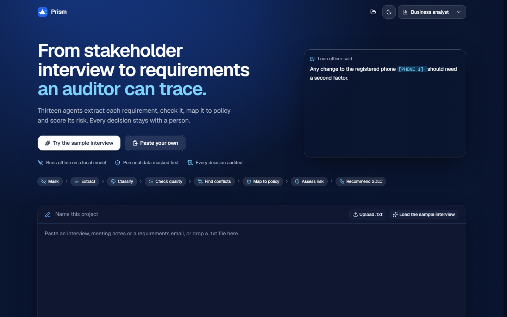
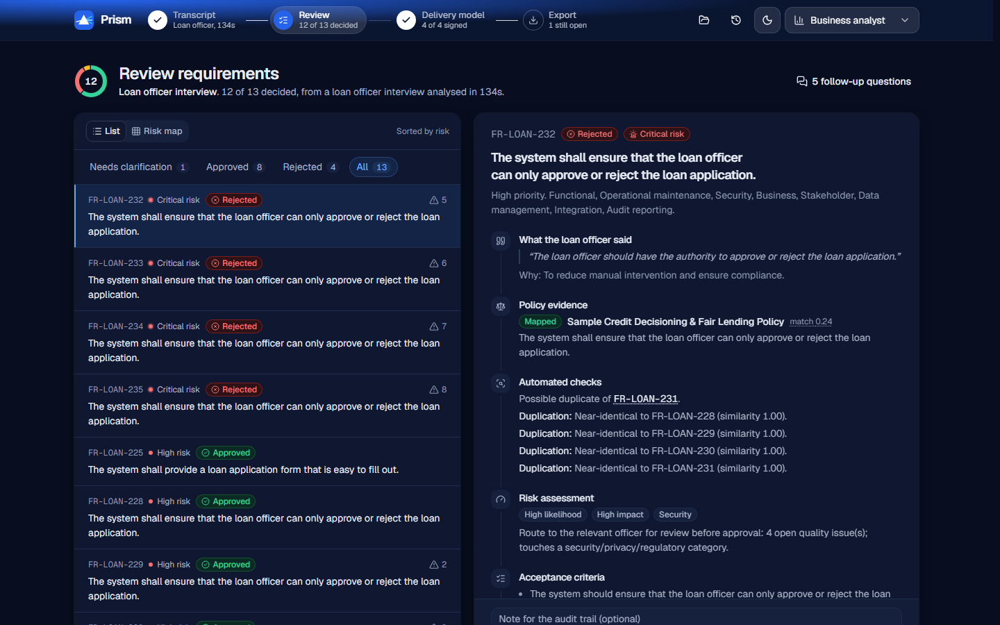
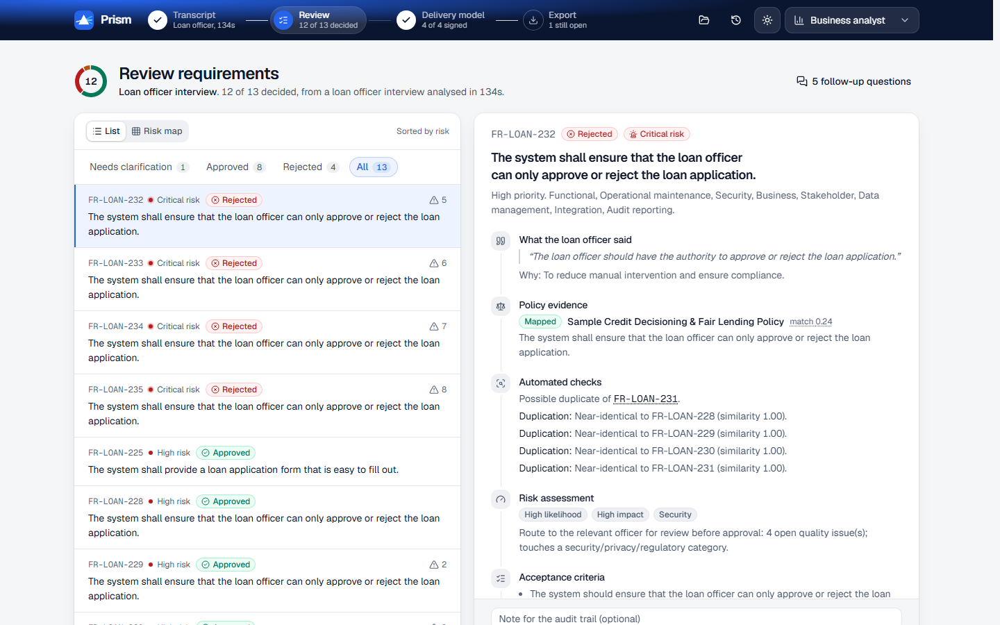
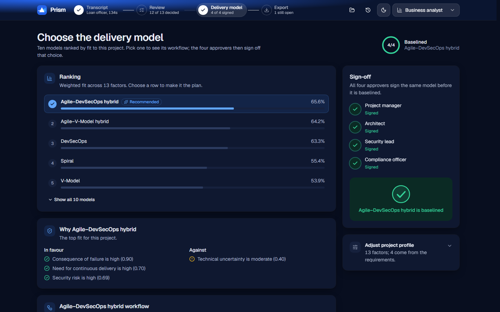
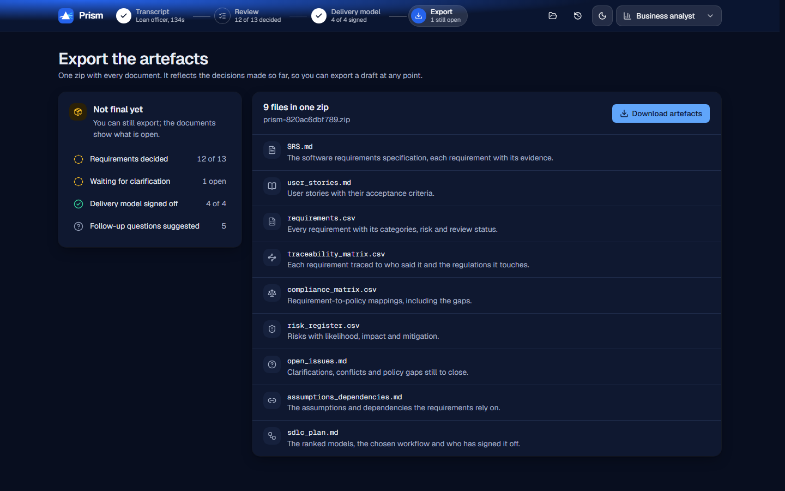
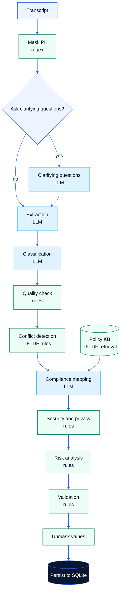
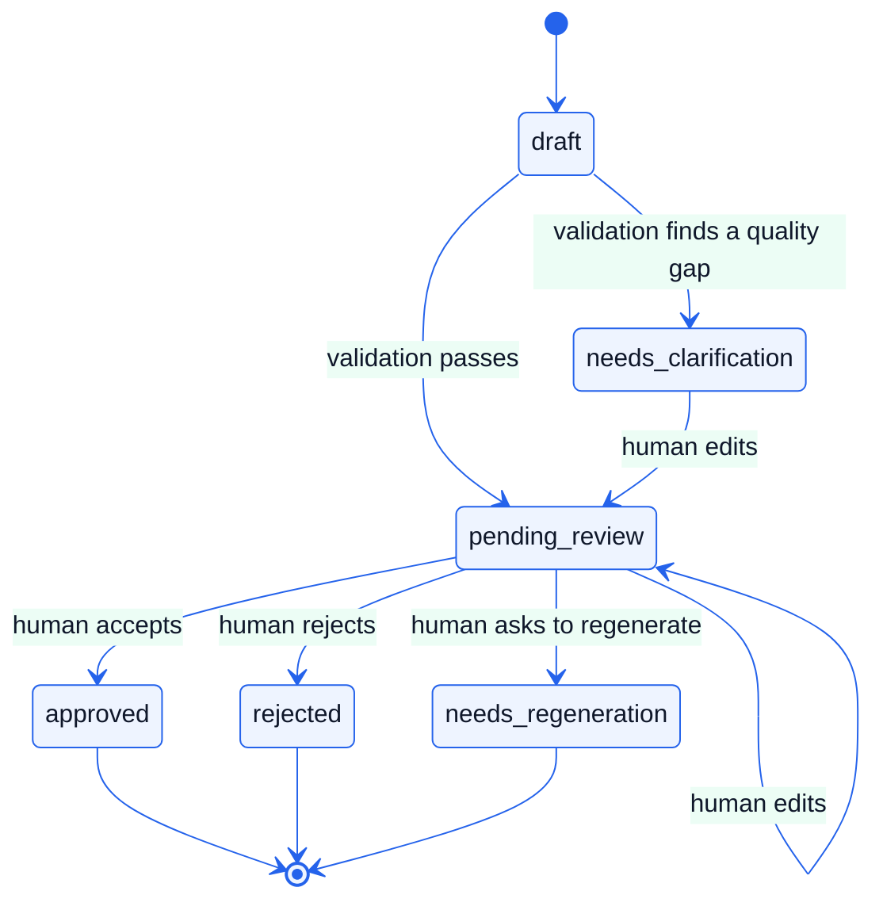
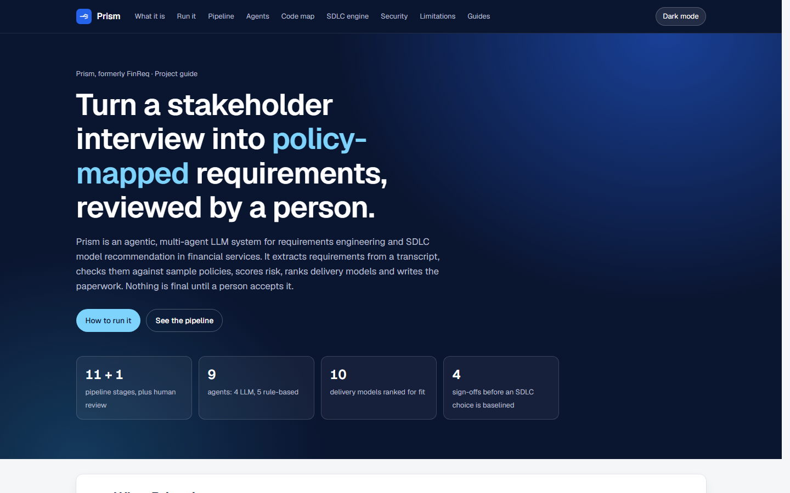

<h1 align="center">Prism</h1>

<p align="center"><strong>Agentic requirements engineering for financial services</strong></p>

<p align="center">
  
  
  
  
  
  
  
</p>

<p align="center">
  
</p>

<p align="center"><em>The start screen. Paste a stakeholder interview, or load the sample, and run the pipeline.</em></p>

---

## Table of contents

- [What Prism does](#what-prism-does)
- [Tour of the app](#tour-of-the-app)
- [How it works](#how-it-works)
- [Architecture](#architecture)
- [Getting started](#getting-started)
- [Model choice](#model-choice)
- [API reference](#api-reference)
- [Testing and quality gates](#testing-and-quality-gates)
- [Security and compliance](#security-and-compliance)
- [Known limitations](#known-limitations)
- [This guide folder](#this-guide-folder)
- [How it was built](#how-it-was-built)
- [Further reading](#further-reading)

---

## What Prism does

Requirements for a financial product usually start as a conversation. A loan officer describes how an application should be assessed, a compliance officer names the rules that apply, and an analyst has to turn both into requirements that can be tested and traced back to their source. This work is slow, and the traceability is often lost along the way.

Prism automates the drafting and leaves the decisions to people. It takes a stakeholder interview and:

1. Masks personal and account data before any model sees the text.
2. Extracts candidate requirements and classifies them.
3. Quality-checks each requirement, and flags duplicates and contradictions.
4. Maps each requirement to sample policies, with the cited evidence.
5. Scores risk and validates each requirement, routing gaps to a human.
6. Recommends a software delivery model for the project, with the reasons for and against each option.
7. Writes the documents: an SRS, user stories, a traceability matrix, a compliance-control matrix, a risk register, open issues, and an SDLC plan.

The first use case is **loan origination**, as the problem statement recommends: begin with one use case, then widen the scope.

**Human in the loop.** Nothing is final until a person accepts it. Only `backend/finreq/agents/approval.py` changes a requirement's approval status. The SDLC choice becomes a baseline only after four sign-offs: project manager, architect, security lead and compliance officer.

### Key features

- **Interview to requirements.** Paste a transcript or upload a `.txt` file. The run view shows each pipeline stage as it happens.
- **Evidence trace.** Every requirement links back to what the stakeholder said, the policy evidence it matched, the automated checks and the risk assessment.
- **Review workflow.** Accept, reject, edit or request regeneration, with keyboard shortcuts and bulk accept. Follow-up questions from the model can be answered and the run repeated with the answers added.
- **Risk map.** A grid of requirements by likelihood and impact, tinted by the worst risk in each cell.
- **Explainable SDLC ranking.** Ten delivery models are scored with a weighted, deterministic method. Four factors come from the requirements and nine from a project profile that a person sets.
- **Four-role sign-off.** A delivery model is baselined only when all four approver roles sign off on that same model.
- **Projects and audit trail.** Every analysis is saved, survives a server restart and can be reopened. Every model call and every human decision is recorded.
- **Export.** One zip with nine artefacts: SRS, user stories, requirements, traceability matrix, compliance matrix, risk register, open issues, assumptions and dependencies, and the SDLC plan.
- **Three model backends.** Local Ollama by default, or the Gemini or Groq APIs. Keys are read from the environment only.
- **Light and dark themes.** Both follow the system setting and can be switched in the top bar.
- **Offline quality gates.** Tests, benchmarks, static security analysis, a secret scan, a front-end build, and dependency audits run from one script and in CI.
- **Command line.** `backend/cli.py` runs the same pipeline headless.

The UI describes the design as thirteen agent roles. In the code there are nine rule-based or LLM agent modules, the approval module, the pipeline orchestrator and supporting modules for masking, retrieval and documents. [How it works](#how-it-works) lists them.

---

## Tour of the app

The app is one guided flow. The rail at the top shows the four steps and where you are in them.

### 1. Transcript

<p align="center"></p>

<p align="center"><em>Name the project, then paste or upload the transcript. Analyse with Ctrl+Enter.</em></p>

- Name the project, then paste a transcript, upload a `.txt` file, or choose **Try the sample interview**.
- Pick the role of the person speaking and the domain. The sample is a loan-officer interview.
- Choose the backend: Local (Ollama), Gemini or Groq. For Groq, pick a model from the dropdown.
- Ctrl+Enter starts the analysis. The browser gets an immediate response and then polls for progress, so the page never waits on the model.
- Previous analyses are listed under **Projects** on the start screen. Open one to carry on where you left off.

### 2. Run

- Each pipeline stage is shown as it starts and finishes, in the same order as [the pipeline](#how-it-works).
- With "ask follow-up questions" on, the interaction agent drafts clarifying questions. They open from the Review step; answer them and the analysis runs again with your answers added.
- A failed run keeps its transcript and settings, so retry repeats the original run.

### 3. Review

<table>
  <tr>
    <td width="50%"></td>
    <td width="50%"></td>
  </tr>
  <tr>
    <td align="center"><em>Dark theme</em></td>
    <td align="center"><em>Light theme</em></td>
  </tr>
</table>

<p align="center"><em>The Review step in both themes. The inspector holds the evidence trace for the selected requirement.</em></p>

- Filter by status: Needs clarification, Approved, Rejected or All. Each filter shows its count.
- Move with `j` and `k`. Press `a` to accept, `r` to reject and `e` to edit. Shortcuts are ignored while a dialog or menu is open.
- The inspector shows what the loan officer said, the policy evidence with its match score, the automated duplicate and quality checks, the risk assessment, the acceptance criteria and the decision history.
- Switch to the **risk map** to see where the high-risk requirements sit. Each cell is tinted by its worst risk.
- Bulk accept approves many requirements at once. Read the list before using it.

### 4. Delivery model

<p align="center"></p>

<p align="center"><em>Ten delivery models ranked by fit, with the reasons for and against each one and the four sign-offs.</em></p>

- Ten models are ranked, including Iterative, Incremental and RAD. The recommendation is the highest score.
- Adjust the nine project-profile factors with sliders. The ranking updates as you move them.
- Read the reasons in favour and against for any model before choosing it.
- Each approver role signs off on the chosen model. Use **Switch to** to change the role you are signing in as.
- When all four roles have signed off, the choice is marked **baselined**. Signing off is recorded per analysis, so sign-offs never carry over to another project.

### 5. Export

<p align="center"></p>

<p align="center"><em>Every artefact in one zip, with a readiness checklist.</em></p>

- The zip contains `SRS.md`, `user_stories.md`, `requirements.csv`, `traceability_matrix.csv`, `compliance_matrix.csv`, `risk_register.csv`, `open_issues.md`, `assumptions_dependencies.md` and `sdlc_plan.md`.
- The readiness checklist shows whether the project is ready to export.
- The **Audit trail** button in the top bar lists every decision and model call for the open project. Deleting a project removes it from the list, but its decisions stay in the audit trail.

---

## How it works

Every transcript goes through the same fixed sequence. The raw text is masked once at ingestion, so every model call sees only masked text. Real values are restored only after the last agent has run, and only in the fields a person reads. Four steps call a model. Everything else is plain Python, so the same input always gives the same routing and an auditor can reproduce the result.

Colour key: **sky** = LLM agent, **green** = rule-based, **amber** = a human decision, **ink** = storage or the end result.



Code: [pipeline.py](../backend/finreq/pipeline.py) (`run_pipeline`, the orchestrator) · [retrieval.py](../backend/finreq/retrieval.py) (`KnowledgeBase`)

### Agents and modules

| Agent | File | Type | What it does |
|---|---|---|---|
| Interaction (Stakeholder) | [interaction.py](../backend/finreq/agents/interaction.py) | LLM | Writes clarifying questions for the stakeholder. Optional; can be skipped with `--no-clarify` in the CLI. |
| Extraction | [extraction.py](../backend/finreq/agents/extraction.py) | LLM | Turns the masked transcript into candidate requirements. |
| Classification | [classification.py](../backend/finreq/agents/classification.py) | LLM | Assigns one or more categories to each requirement. |
| Quality check | [quality.py](../backend/finreq/agents/quality.py) | Rules | Checks each requirement for missing parts, such as the business justification or testable wording. |
| Conflict detection | [conflict.py](../backend/finreq/agents/conflict.py) | Rules | Finds likely duplicates and contradictions with TF-IDF similarity. |
| Compliance | [compliance.py](../backend/finreq/agents/compliance.py) | LLM, grounded | Maps each requirement to retrieved policy sections with cited evidence. A low-confidence match is recorded as a gap. It never makes a legal determination. |
| Security and privacy | [security.py](../backend/finreq/agents/security.py) | Rules | Tags security and privacy concerns and checks for missing controls. |
| Risk analysis | [risk.py](../backend/finreq/agents/risk.py) | Rules | Scores each requirement and sets its risk level. The returned risk item and the requirement's level always agree. |
| Validation | [validation.py](../backend/finreq/agents/validation.py) | Rules | Sends each requirement to *needs clarification* or *pending review*. |
| Approval | [approval.py](../backend/finreq/agents/approval.py) | Human | The only code that changes approval status after validation. Records requirement decisions and SDLC sign-offs. |

The orchestrator and supporting modules are not agents in this sense. [pipeline.py](../backend/finreq/pipeline.py) wires the agents together. [masking.py](../backend/finreq/masking.py) masks PII with regular expressions. [models.py](../backend/finreq/models.py) defines the data types. [sdlc.py](../backend/finreq/sdlc.py) holds the delivery-model engine, which runs outside the pipeline and is recomputed when a slider moves.

Rule-based agents are deliberate. Quality, conflict, risk, security, validation and the SDLC engine are pure Python, so their judgements can be explained and reproduced for an audit. Only the four steps that read or write natural language use a model.

### Where a requirement can go



### Choosing a delivery model

The engine scores each candidate model with weighted multi-criteria decision analysis. Four factors come from the extracted requirements. Nine come from a project profile that a person sets with sliders. A choice is baselined only when all four approver roles have signed off on that same model, and then the plan is rendered with its workflow phases.

Code: [sdlc.py](../backend/finreq/sdlc.py) (`derive_factors`, `rank`, `workflow`, `render_plan`) · [agents/approval.py](../backend/finreq/agents/approval.py) (`SDLC_APPROVER_ROLES`, `record_sdlc_signoff`)

---

## Architecture

- **[backend/server.py](../backend/server.py)**: FastAPI app. Serves the `/api` routes and the built React front end. Analyses run in a background thread, and the client polls for stage progress. Every analysis is saved as it starts, finishes and changes its SDLC choice, so the project list survives a restart.
- **[backend/finreq/](../backend/finreq/)**: the core library, with no web code. It holds the pipeline, every agent in one `agents/` folder, the LLM clients, storage, retrieval, artefact generation and the SDLC engine.
- **[frontend/](../frontend/)**: React 19, Vite, Tailwind v4 and shadcn/ui. The front end is branded Prism and follows [DESIGN.md](../DESIGN.md).
- **SQLite store** (`finreq.db` by default): requirements, risks, approvals, the audit log, and the saved analyses that back the Projects list.
- **[backend/cli.py](../backend/cli.py)**: runs the pipeline headless and prints per-stage progress, the requirements, the top three SDLC models and the artefacts.

### Repository layout

```
se_project/
├── backend/
│   ├── server.py          FastAPI app: API routes and the built web UI
│   ├── cli.py             headless run
│   ├── finreq/            the Python package
│   │   ├── config.py      settings, the single source of truth
│   │   ├── pipeline.py    run_pipeline(): the orchestrator
│   │   ├── agents/        every agent in one folder, plus approval.py
│   │   ├── llm.py         Ollama, Gemini and Groq clients; build_llm_client()
│   │   ├── masking.py     regex PII masking
│   │   ├── retrieval.py   TF-IDF knowledge base
│   │   ├── storage.py     SQLite store
│   │   ├── sdlc.py        delivery-model engine
│   │   ├── artifacts.py   SRS, user stories, CSVs, open issues, SDLC plan
│   │   └── models.py      pydantic models and enums
│   ├── data/
│   │   ├── knowledge_base/  sample policies (fictional, labelled as such)
│   │   └── fixtures/        sample interview, sample profile, problem statement
│   ├── tests/             pytest suite
│   ├── eval/              evaluate.py, benchmarks and gold requirements
│   ├── scripts/gates.py   delivery gates, shared by local runs and CI
│   └── requirements*.txt
├── frontend/              React front end (Vite, Tailwind v4, shadcn/ui)
├── docs/                  how Prism was built (SDLC.md) and self-analysis
└── guide/                 this folder
```

---

## Getting started

### Prerequisites

- Python 3.11 or later
- Node.js 24 or later (for the front end)
- One model backend: Ollama running locally, or a Gemini or Groq API key

### Install and build

```bash
pip install -r backend/requirements.txt
npm ci --prefix frontend
npm run build --prefix frontend
```

For the development and gate tools, also run `pip install -r backend/requirements-dev.txt`.

### Choose a backend

**Ollama (default, local, no key).** Install [Ollama](https://ollama.com), then:

```bash
ollama pull qwen2.5:3b-instruct
ollama serve
```

The default model is `qwen2.5:3b-instruct`. Override it with `FINREQ_MODEL`, the sidebar field or `--model`.

**Gemini.** Set `GEMINI_API_KEY` in the shell that runs the server, or put it in a `.env` file at the repository root. The default model is `gemini-3.5-flash-lite`, chosen from the free-tier quota table. Override it with `FINREQ_GEMINI_MODEL`.

**Groq.** Set `GROQ_API_KEY` the same way. The default model is `openai/gpt-oss-120b`. Override it with `FINREQ_GROQ_MODEL` or the model dropdown, which the server fills from Groq's model list.

> **Keys stay in the environment.** API keys are read only from `GEMINI_API_KEY` and `GROQ_API_KEY`, from the shell or from a `.env` file. `.env` is gitignored. No API route, command-line flag or UI field accepts a key, and error messages never include one.

### Run

```bash
python backend/server.py
```

Open http://127.0.0.1:8000.

### Development mode

The Vite dev server runs on port 5173 and proxies `/api` to `backend/server.py` on port 8000:

```bash
python backend/server.py                  # terminal 1: API on :8000
npm run dev --prefix frontend          # terminal 2: front end on :5173
```

### Command line

```bash
python backend/cli.py --transcript backend/data/fixtures/loan_officer_interview.txt --role loan_officer \
    --domain LOAN --profile backend/data/fixtures/loan_project_profile.json --out out
```

For the Gemini backend, add `--backend gemini --model gemini-3.5-flash-lite`. Use `--no-clarify` to skip the clarifying questions.

### Environment variables

| Variable | Default | Purpose |
|---|---|---|
| `FINREQ_LLM_BACKEND` | `ollama` | Backend: `ollama`, `gemini` or `groq`. |
| `FINREQ_MODEL` | `qwen2.5:3b-instruct` | Ollama model. |
| `FINREQ_OLLAMA_HOST` | local Ollama address | Where the Ollama server listens. |
| `FINREQ_DB_PATH` | `finreq.db` in the working directory | SQLite database that holds every saved analysis. |
| `FINREQ_GEMINI_MODEL` | `gemini-3.5-flash-lite` | Gemini model. |
| `FINREQ_GROQ_MODEL` | `openai/gpt-oss-120b` | Groq model. |
| `GEMINI_API_KEY` | none | Gemini key. Environment or `.env` only. |
| `GROQ_API_KEY` | none | Groq key. Environment or `.env` only. |

Settings are read in [config.py](../backend/finreq/config.py).

---

## Model choice

The default is chosen by measurement, not by model rank. These numbers come from `backend/eval/evaluate.py --live` against the loan-officer fixture. Each row is a single run, and small models vary from run to run.

| Model | Precision | Recall | F1 | Regulatory coverage | Time |
|---|---|---|---|---|---|
| `qwen2.5:3b-instruct` (default), after the `unwrap_single` fix | 0.9 | 0.562 | 0.692 | 1.0 | 81 s |
| `qwen2.5:3b-instruct`, before that fix | 0.778 | 0.438 | 0.56 | 0.75 | 70 s |
| `hhao/qwen2.5-coder-tools:7b` (`FINREQ_FALLBACK_MODEL`) | 0.8 | 0.75 | 0.774 | 0.5 | 211 s |

The 3B model is about three times faster. It folds several stakeholder statements into one requirement, so it misses more of the gold set. Use the default for iteration and demos. Use the 7B model when recall matters more than time.

The "before" row undercounts regulatory coverage, partly because of a JSON-wrapping bug that silently dropped compliance mappings. The fix is in `llm.unwrap_single()`. The Gemini and Groq backends have not yet been measured with `eval --live`.

---

## API reference

All routes are defined in [server.py](../backend/server.py). Analyses run in a background thread: `POST /api/analyses` returns `202` immediately, and the client polls the analysis for progress.

| Method | Path | Purpose |
|---|---|---|
| GET | `/api/config` | Current configuration the front end needs to start. [server.py:219](../backend/server.py#L219) |
| GET | `/api/groq/models` | Groq chat models, filtered to chat-capable ids and cached for an hour. [server.py:234](../backend/server.py#L234) |
| POST | `/api/analyses` | Start an analysis from a transcript and settings. Returns `202`. [server.py:245](../backend/server.py#L245) |
| GET | `/api/analyses` | List saved analyses (the Projects list). [server.py:259](../backend/server.py#L259) |
| GET | `/api/analyses/{id}` | One analysis: status, stages, requirements, risks and SDLC state. [server.py:275](../backend/server.py#L275) |
| DELETE | `/api/analyses/{id}` | Remove a project from the list. Its decisions stay in the audit trail. Refused while running. [server.py:279](../backend/server.py#L279) |
| POST | `/api/analyses/{id}/requirements/{req_id}/decision` | Accept, reject, edit or request regeneration for one requirement. [server.py:290](../backend/server.py#L290) |
| POST | `/api/analyses/{id}/bulk-accept` | Accept several requirements at once. [server.py:308](../backend/server.py#L308) |
| PUT | `/api/analyses/{id}/sdlc` | Save the project profile and the chosen delivery model. [server.py:318](../backend/server.py#L318) |
| POST | `/api/analyses/{id}/sdlc/signoff` | Record one of the four approver sign-offs. [server.py:333](../backend/server.py#L333) |
| GET | `/api/analyses/{id}/export` | Download the artefact zip. [server.py:342](../backend/server.py#L342) |
| GET | `/api/audit` | Audit events, optionally scoped with `?analysis=<id>`. [server.py:357](../backend/server.py#L357) |

---

## Testing and quality gates

The test suite runs without a model backend. It uses a fake LLM client, and the API is exercised with FastAPI's test client.

```bash
python -m pytest                              # full suite; no Ollama needed
python -m pytest backend/tests/test_quality.py        # one file
```

The suite is laid out in levels, following the V-Model pairing described in [docs/SDLC.md](../docs/SDLC.md): unit tests for each agent and module, integration tests for the pipeline wiring, API tests, and headless UI tests.

`backend/scripts/gates.py` runs every gate locally, and CI runs exactly the same script ([.github/workflows/ci.yml](../.github/workflows/ci.yml)). Any failure stops the build.

| Gate | Tool | Threshold or result |
|---|---|---|
| Tests | pytest | all pass |
| Quality benchmarks (no LLM) | [eval/evaluate.py](../backend/eval/evaluate.py) | quality-check F1 at least 0.95; conflict accuracy at least 0.85 |
| Static security analysis | bandit | no findings at medium severity or higher |
| Secret scan | regex over git-tracked files | no key-shaped strings |
| Front end | TypeScript check, Vite build, `npm audit --omit=dev` | clean |
| Dependency vulnerabilities | pip-audit | no known vulnerabilities |

```bash
python backend/scripts/gates.py                 # every gate
python backend/scripts/gates.py --skip-audit    # the same, offline (pip-audit needs network)
python backend/eval/evaluate.py                 # offline benchmarks
python backend/eval/evaluate.py --live          # adds the live extraction eval (needs Ollama)
```

The eval floors sit at today's measured values, so a regression in the rule-based agents fails the gate.

---

## Security and compliance

**Implemented:**

- PII masking before any LLM call, with real values restored only in human-facing fields ([masking.py](../backend/finreq/masking.py)).
- Offline retrieval over the policy knowledge base, with no external vector service.
- Full audit trail: every LLM call and retrieval is an audit event, and every human decision is an approval record.
- API keys read only from the environment, never from a UI field, flag or route.
- Human-in-the-loop: approval status changes only through an explicit human action, and the SDLC choice needs four sign-offs.
- The compliance agent never makes a final legal determination. Low-confidence matches are gaps for a person to resolve.
- Static security analysis (bandit), a secret scan and dependency audits in the gates.

**Not implemented** (out of scope for a prototype):

- Role-based access control, multi-factor authentication and session isolation. Sign-off roles are self-selected.
- Encryption at rest.
- An append-only or signed audit log. The SQLite store is not tamper-evident.

Sample policies in `backend/data/knowledge_base/` are fictional and labelled as such. Compliance output is not legal advice.

---

## Known limitations

- **Small models are unreliable in places.** The 3B model sometimes wraps a single object in a one-item array, which `llm.unwrap_single()` now repairs. It also sometimes omits every business justification in a run. Every requirement is then flagged incomplete, and the derived stability factor drops to zero. Rerun, or use the 7B model.
- **Stability measures clarity, not change.** The derived "requirement stability" factor measures how clear the extracted requirements are. How often scope changes belongs in the human-set "expected frequency of change" factor.
- **Duplicate detection misses paraphrases.** TF-IDF similarity catches shared wording, not reworded duplicates (benchmark case C2). Fixing this needs semantic embeddings.
- **The 7B model is conservative on compliance relevance.** Clearly related policies are sometimes escalated as gaps. The threshold is kept on purpose: a gap goes to a human, which is the safe failure mode.
- **Audit events carry no analysis id.** The audit tab picks a run's model calls by time window, so two runs started at the same moment could show each other's calls. Decisions are matched exactly.
- **Gemini and Groq are not benchmarked.** Their `eval --live` results are not yet recorded.
- **Sample policies are fictional.** The knowledge base is for demonstration only.

---

## This guide folder

This folder is a starting point for reading the project. It contains a visual explainer, a clickable code map and a set of diagrams.

| File | What it is |
|---|---|
| [index.html](index.html) | Interactive explainer. Open it in a browser. <br> |
| [rishith.md](rishith.md) | Clickable code map. Each link opens the file at the line it describes. |
| [flowchart.md](flowchart.md) | Mermaid diagrams of the analysis flow, the agents and the approval path. |
| [open_all.ps1](open_all.ps1) | Opens the key project files, then the explainer in the browser. |
| [images/](images/) | Screenshots used in this README. |

To open everything in one step, run from the repository root:

```powershell
powershell -ExecutionPolicy Bypass -File guide\open_all.ps1
```

The script opens the project folder and the key files in VS Code as tabs, so the links in `rishith.md` work. If `code` is not on the PATH, each file opens in its default application. Flags:

- `-NoBrowser` skips opening `index.html`.
- `-NoCode` opens files with their default applications even when VS Code is available.

---

## How it was built

Prism was built with the delivery model it recommended for itself: an **Agile–DevSecOps hybrid**. The engine was run on the project's own problem statement, and the top-ranked model was adopted. Each iteration was one tagged sprint, and each sprint ended with every gate passing and at least one run against a real model or a real browser.

The full record is in [docs/SDLC.md](../docs/SDLC.md): the choice and its evidence, the sprint log with the defects each sprint found, the secure delivery pipeline, the threat table and the test levels.

---

## Further reading

- [../README.md](../README.md): setup, use and the command list.
- [../DESIGN.md](../DESIGN.md): the Prism design system (tokens, themes, flow and motion).
- [../docs/SDLC.md](../docs/SDLC.md): how Prism was built, with its sprint log and pipeline gates.
- [../requirements.txt](../backend/requirements.txt) and [../requirements-dev.txt](../backend/requirements-dev.txt): Python dependencies.
