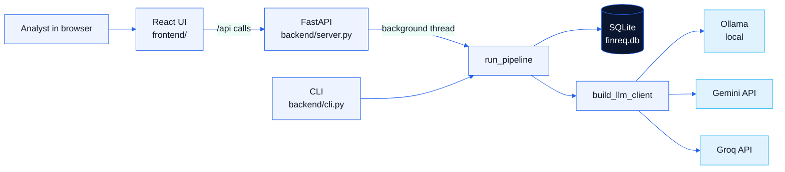
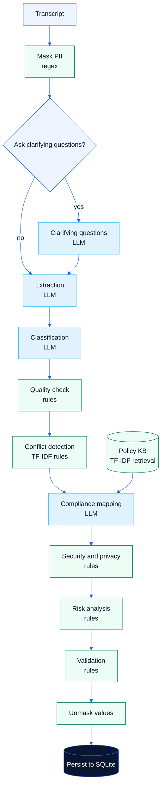
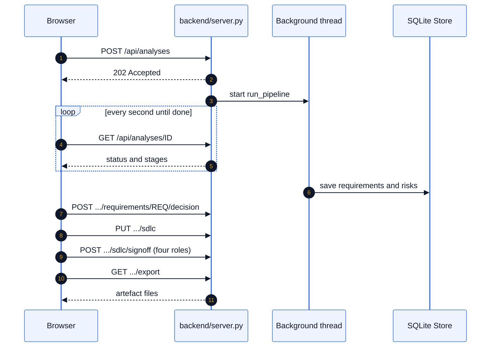
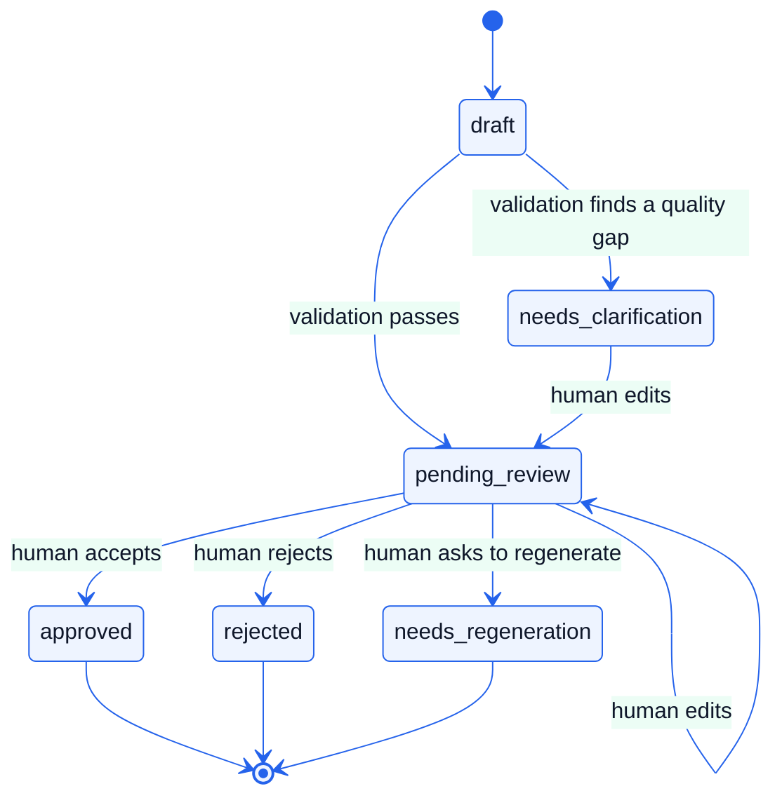
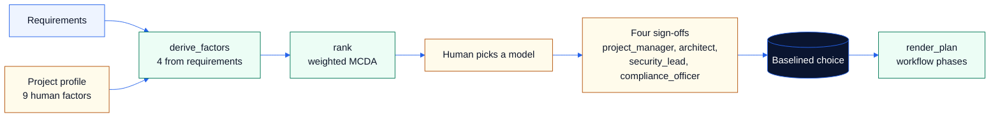

# Prism · What is going on

> How FinReq turns a stakeholder interview into reviewed requirements and an SDLC plan.

Colour key in every diagram: **sky** = LLM agent, **green** = rule-based, **amber** = a human decision, **ink** = storage or the end result.

---

## 1. The big picture

A browser talks to a FastAPI server, which runs the pipeline in a background thread and saves everything to SQLite. The CLI calls the same pipeline directly. The model backend is chosen once, in `build_llm_client`.

Code: [server.py:130 — create_app](../backend/server.py#L130) · [pipeline.py:59 — run_pipeline](../backend/finreq/pipeline.py#L59) · [llm.py:338 — build_llm_client](../backend/finreq/llm.py#L338) · [storage.py:45 — Store](../backend/finreq/storage.py#L45) · [cli.py:34 — main](../backend/cli.py#L34) · [frontend/src/App.tsx:41 — App](../frontend/src/App.tsx#L41)

---

## 2. The pipeline, in order

Every transcript goes through the same fixed sequence. The raw text is masked before any model sees it, and real values are put back only after the last agent has run. The four LLM steps are the only places a model is called. Everything else is plain Python, so the same input always gives the same routing.

Code: [pipeline.py:97 — mask_text](../backend/finreq/pipeline.py#L97) · [pipeline.py:106 — interaction](../backend/finreq/pipeline.py#L106) · [pipeline.py:109 — extraction](../backend/finreq/pipeline.py#L109) · [pipeline.py:114 — classification](../backend/finreq/pipeline.py#L114) · [pipeline.py:117 — quality](../backend/finreq/pipeline.py#L117) · [pipeline.py:120 — conflict](../backend/finreq/pipeline.py#L120) · [pipeline.py:123 — compliance](../backend/finreq/pipeline.py#L123) · [pipeline.py:128 — security](../backend/finreq/pipeline.py#L128) · [pipeline.py:131 — risk](../backend/finreq/pipeline.py#L131) · [pipeline.py:134 — validation](../backend/finreq/pipeline.py#L134) · [pipeline.py:136 — unmask and save](../backend/finreq/pipeline.py#L136) · [retrieval.py:88 — KnowledgeBase](../backend/finreq/retrieval.py#L88)

---

## 3. One analysis, end to end

The browser never waits on the model. It posts the transcript, gets a `202` straight back, then polls for stage progress while a background thread does the work. After the run finishes, the human reviews each requirement, picks an SDLC model, and collects four sign-offs before the export is allowed.

Code: [server.py:245 — POST /api/analyses](../backend/server.py#L245) · [server.py:275 — GET one](../backend/server.py#L275) · [server.py:290 — decision](../backend/server.py#L290) · [server.py:318 — PUT sdlc](../backend/server.py#L318) · [server.py:333 — signoff](../backend/server.py#L333) · [server.py:342 — export](../backend/server.py#L342) · [frontend/src/lib/api.ts:64 — api](../frontend/src/lib/api.ts#L64)

---

## 4. Where a requirement can go

Validation sends each requirement to one of two states. A human then accepts it, rejects it, edits it, or asks for a regeneration. Only the human decision changes the status after validation.

Code: [models.py:51 — ApprovalStatus](../backend/finreq/models.py#L51) · [agents/validation.py:30 — ValidationAgent](../backend/finreq/agents/validation.py#L30) · [agents/approval.py:21 — _ACTION_TO_STATUS](../backend/finreq/agents/approval.py#L21) · [agents/approval.py:33 — record_decision](../backend/finreq/agents/approval.py#L33)

---

## 5. Choosing an SDLC model

The engine scores each candidate model with weighted MCDA. Four factors come from the requirements and nine from a project profile that a human sets with sliders. A choice becomes a baseline only when all four approver roles have signed off on that same model. Then the plan is rendered.

Code: [sdlc.py:75 — derive_factors](../backend/finreq/sdlc.py#L75) · [sdlc.py:111 — rank](../backend/finreq/sdlc.py#L111) · [sdlc.py:204 — workflow](../backend/finreq/sdlc.py#L204) · [sdlc.py:208 — render_plan](../backend/finreq/sdlc.py#L208) · [agents/approval.py:19 — SDLC_APPROVER_ROLES](../backend/finreq/agents/approval.py#L19) · [agents/approval.py:70 — record_sdlc_signoff](../backend/finreq/agents/approval.py#L70)

---

## 6. The UI, step by step

The web app is a guided flow. The start screen takes the transcript, the live run shows stage progress, then the four steps in the rail take the reviewer from the requirements to the export. The rail also has a transcript step for going back to the source.

```mermaid
%%{init: {'theme':'base','themeVariables':{'primaryColor':'#eef4ff','primaryTextColor':'#0f172a','primaryBorderColor':'#2563eb','lineColor':'#2563eb','secondaryColor':'#ecfdf5','tertiaryColor':'#f5f6f8','fontFamily':'Geist, system-ui, sans-serif'}}}%%
flowchart LR
  st["Start<br/>paste or sample transcript"] --> rn["Run<br/>live stage progress"]
  rn --> rv["Review<br/>accept, reject, edit"]
  rv --> dm["Delivery model<br/>factors, ranking, sign-offs"]
  dm --> ex["Export<br/>download artefacts"]
  classDef llm fill:#e0f2fe,stroke:#38bdf8
  classDef rule fill:#ecfdf5,stroke:#047857
  classDef human fill:#fffbeb,stroke:#b45309
  classDef ink fill:#0a1530,color:#fff,stroke:#2563eb
  class rn llm
  class rv,dm human
  class ex ink
```

Code: [frontend/src/App.tsx:41 — App](../frontend/src/App.tsx#L41) · [frontend/src/components/StepRail.tsx:7 — STEPS](../frontend/src/components/StepRail.tsx#L7) · [frontend/src/components/RunView.tsx:34 — RunView](../frontend/src/components/RunView.tsx#L34) · [frontend/src/components/review/ReviewStep.tsx:29 — ReviewStep](../frontend/src/components/review/ReviewStep.tsx#L29) · [frontend/src/components/DeliveryStep.tsx:23 — DeliveryStep](../frontend/src/components/DeliveryStep.tsx#L23) · [frontend/src/components/ExportStep.tsx:27 — ExportStep](../frontend/src/components/ExportStep.tsx#L27)
